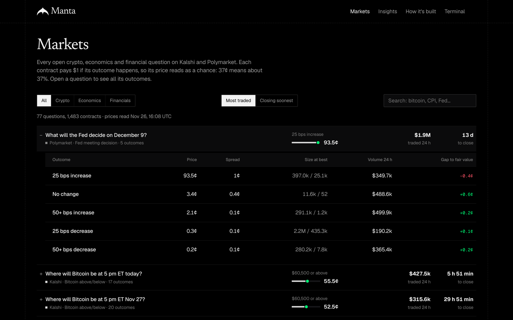
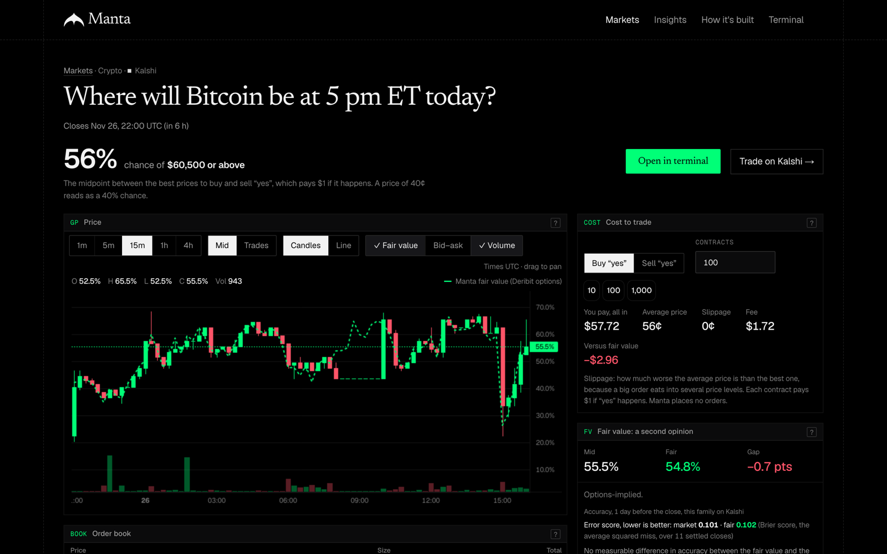

<p align="center">
  <a href="https://mantamarkets.com">
    <picture>
      <source media="(prefers-color-scheme: dark)" srcset="docs/images/header-dark.svg">
      
    </picture>
  </a>
</p>

<p align="center">
  <a href="https://mantamarkets.com">Live site</a> ·
  <a href="docs/product.md">Docs</a> ·
  <a href="LICENSE">License</a>
</p>

<p align="center">
  <a href="https://github.com/carsonturnr/manta-markets/actions/workflows/ci.yml"></a>
  <a href="LICENSE"></a>
  
  
  
  <a href="https://github.com/nautechsystems/nautilus_trader"></a>
</p>

Manta covers the crypto, economics and financial contracts on Kalshi and Polymarket (never sports)
and gives you the tools to work with them: live order books and trades, charts from Manta's own
recordings, what a trade really costs after fees, the same question compared across venues, and
alerts. It is read-only: Manta places no orders.

<p align="center">
  <a href="https://mantamarkets.com/terminal"></a>
</p>

**Built on [NautilusTrader](https://github.com/nautechsystems/nautilus_trader)** (LGPL-3.0), used
as an installed library for the history catalog and backtesting. Manta's own code is the recorder,
the pricing and analytics, the site and the measurement.

## The site

- **Markets** (`/markets`): every open question, busiest first; each opens to its outcomes with
  price, spread, size, volume and the gap to fair value.
- **Market page** (`/m/<venue>/<event>`): one question's chart, order book, depth, trades, cost to
  trade, fair value, every outcome and a short written brief.
- **Terminal** (`/terminal`): the same panels in one live workspace, Kalshi books and trades
  streamed from the recorder, with a ⌘K command bar.
- **Insights** (`/insights`): when trading is cheapest, which price bands the market gets wrong,
  and whether crossing between venues pays after fees.
- **How it's built** (`/how-its-built`): the system, its measured numbers and every recording gap.
- **Accounts**: watchlists, email alerts and an API of Manta's analytics (`/docs/api`).

| Markets | Market page |
|---|---|
| <a href="https://mantamarkets.com/markets"></a> | <a href="https://mantamarkets.com/markets"></a> |

## Numbers

Measured, with their dates. The live figures are on [How it's built](https://mantamarkets.com/how-its-built).

- **3.54 billion** venue messages recorded from 2026-11-12 to 2026-11-26, from six venues.
- **Coverage 99.48% to 99.997%** per venue over that time (the share of time not inside a
  recording gap); Deribit is the lowest.
- **0 book mismatches** in 5.6 million rebuilt order-book updates, checked against the venue
  (2026-11-13).
- **93 ms** median from a Kalshi message reaching the recorder to the terminal receiving it
  (2026-11-23).
- **187 tests**: 66 Go, 57 Python, 64 site (2026-11-26).

## What worked and what did not

Sources: [docs/decisions.md](docs/decisions.md) (dated measurements), the market maker's report
in [docs/plan-market-maker.md](docs/plan-market-maker.md), and read-only queries of Manta's database on 2026-11-27
(the recorder's quality report and `manta.predictions`). Anything marked *provisional* will change.

### Worked

- **The recorder.** Running since 2026-11-12 17:05 UTC. By its quality report of 2026-11-27
  18:02 UTC it had recorded 3,781,033,089 messages (Kalshi 3,509,407,688). Coverage, the share of
  time not inside a logged gap: Binance 99.997%, Polymarket 99.995%, Coinbase 99.981%, Kraken
  99.977%, Kalshi 99.755%, Deribit 99.345%. Every gap is logged with its start and end (244 in all)
  and shown on [How it's built](https://mantamarkets.com/how-its-built#quality). It is the only
  source of Kalshi order-book history: Kalshi does not publish one.
- **Rebuilt order books match the venue.** 0 mismatches over 5.6 million updates and 9,184 REST
  comparisons (2026-11-13), and 0 over 13.3 million updates when replay covered all 11 Kalshi
  families (2026-11-17).
- **The tools on the site** (Markets, the Market page, the live Terminal, Insights, How it's
  built) and the **API** of derived analytics (`/docs/api`, live since 2026-11-23). The terminal's
  live stream reaches the browser 93 ms (median) after a Kalshi message reaches the recorder
  (2026-11-23).
- **Event response** (how markets move around a scheduled release) is built and ran end to end on
  a stand-in hour; no real release has happened since economics recording began. The first is US
  payrolls on 2026-12-04.
- **Arbitrage after fees is measured, not assumed.** On 2026-11-25, 8 of 52 questions listed on
  both Kalshi and Polymarket crossed before fees and 7 after both venues' taker fees. It is a
  one-minute snapshot: no history is kept.
- **Tests.** 187: 66 Go, 57 Python, 64 site (counted 2026-11-27). Every fee and cost formula is
  tested against hand-worked numbers; the backtest has none of its own outside the market maker's
  branch.

### Did not work, or not well

- **Fair value is not an edge.** Priced from Deribit's options, it is about as accurate as
  Kalshi's own midpoint. Brier score (average squared miss; lower is better), Kalshi's Bitcoin and
  Ether contracts, 2026-11-14 to 11-27: 5 minutes before the close 0.1336 vs 0.1336 (5,280
  predictions, 2,619 events); 1 hour 0.0994 vs Kalshi's 0.1006 (12,957; 1,082); 1 day 0.0847 vs
  0.0843 (713; 42). The site shows it as a second opinion with this record, not a signal.
- **Fair value barely predicts the next move.** Over 2.4 million samples on six days, Kalshi's
  price closed 1.2% of its gap to our fair value within 60 s and 3.0% within 5 minutes; it explains
  0.1% of the moves (R² 0.001), and a gap of 1¢ or more pointed the right way 52.8% of the time
  (627,529 cases).
- **The market maker loses money on every day** (backtest, every fill valued at Kalshi's
  settlement). Kalshi's hourly "Bitcoin above $X" contracts, 5 contracts at the best bid and ask,
  backtested with NautilusTrader on three days it was not tuned on: 2026-11-18 −$235.51, 11-22
  −$98.77, 11-23 −$170.07. In all **−$504.35 on 70,021 contracts, −0.72¢ a contract, against $0
  for not quoting**. On the three tuning days it lost −$610.94 (−0.93¢).
  - Why: it earns the spread (+$350.96) but the price moves against it in the minute after its
    fills (−$838.94). Firms next to Kalshi's servers are about 1 ms away; we see the market about
    57 ms late and need about 56 ms more to cancel, so our orders are the stale ones left when
    better-informed traders arrive (the "pick-offs"). Doubling our order delay to 112 ms changes
    little (−$509.63): the gap to the incumbents is the problem, not a few milliseconds.
  - 17% of its orders were refused by Kalshi's limit of 10 orders a second, but lifting the limit
    (a hypothetical run) loses more, −$539.12, so a faster order tier would not help.
  - Kalshi's 15-minute Bitcoin contracts lose too: −$442.72 on the same days (−0.97¢ a
    contract), with the setting tuned on the hourly ones.
- **Limits of the backtest.** Our simulated orders never change the recorded market, so results
  hold only for small sizes. Kalshi publishes only total size per price, so our place in the queue
  is an estimate between a pessimistic and an optimistic bound. The first version missed
  pick-offs and counted about half the fills; it was corrected on 2026-11-25.
- **Data lost.** Deribit: 1 h 41 min (2026-11-20 19:34–21:15 UTC) and 37 min (2026-11-27
  09:00–09:37 UTC). Kalshi: 2026-11-19 08:00–10:00 UTC is nearly empty in the archive (recorder
  restart at 09:31). The market maker's fair-value measurement also left out 4.4 hours of input
  because the laptop running it slept.
- **Stale prices early on.** Until 2026-11-13 the tracker read Kalshi's market list, which trails
  the live order book by up to about a minute; its statistics from before then are partly against
  stale prices.
- **A costly mistake.** The market brief first ran on a large model with thinking, cached for 5
  minutes, and cost $22 in one day. It now runs on a small model, cached 30 minutes and capped per
  day.

### Paper trading: not done

The plan ended with paper trading on Kalshi's demo environment. It was dropped once the backtest
showed the strategy loses: the demo's order book and traders are not the real ones, so demo fills
could test the plumbing but never change that answer. The paper-trading bot
(backtest/src/manta_backtest/paper.py) is written and unit-tested but has never run.

## How it's built

```
venues (Kalshi, Polymarket, Deribit, Coinbase, Kraken, Binance)
   │  WebSocket / REST, read-only
   ▼
recorder (Go, on a VM) ──► raw hourly gzip JSONL ──► nightly archive (Storage Box)
   │        │                     │
   │        │ replay files        └─► backtest/ (Python + NautilusTrader Parquet catalog)
   │        └─► 1-minute candles for the charts
   │ live relay (Kalshi books and trades) ──► terminal
   ▼
pricing jobs (Python, every minute) ──► Postgres (Supabase, schema `manta`)
                                              │  read-only login
                                              ▼
                                   site (Next.js 16, React 19, TypeScript, Vercel)
```

| Folder | What | Stack |
|---|---|---|
| `recorder/` | records raw venue messages; status, replay, relay and normalizer tools | Go |
| `pricing/` | fair values, distributions, liquidity, accuracy, alerts | Python 3.13, uv |
| `backtest/` | recordings → NautilusTrader catalog | Python 3.13, NautilusTrader |
| `site/` | the product site | Next.js, Clerk sign-in, Postgres |
| `db/` | Postgres schema | SQL |
| `infra/deploy/` | VM deploy scripts and systemd units | bash, systemd |
| `docs/` | product spec, design notes per milestone, dated decisions | |

## Run it locally

None of the steps below need an account or a secret.

```
# Tests
cd pricing  && uv run pytest -q
cd recorder && go test ./...
cd site     && npm ci && npm test

# Record live data into ./data/raw (Kalshi through its public REST API when no key is set)
cd recorder && go run ./cmd/recorder -out ../data/raw
go run ./cmd/status -in ../data/raw          # what was recorded, and every gap

# Price Kalshi's Bitcoin contracts from Deribit's options, in the terminal
cd pricing && uv run manta-fair
```

The site reads Postgres. With a local Postgres (any Postgres 15+):

```
createdb manta
cp .env.example .env                 # DATABASE_URL=postgresql://localhost:5432/manta
cd pricing && uv run --env-file ../.env manta-snap --init                  # tables and logins
cd ../recorder && go run ./cmd/contracts -out ../data/contracts.json      # today's listing
cd ../pricing && uv run --env-file ../.env manta-contracts ../data/contracts.json   # fill it
cd ../site && cp .env.example .env.local && npm run dev                    # http://localhost:3000
```

Sign-in, the waitlist, replay and alerts need their own services (Clerk, Resend, the replay
server); `.env.example` and `site/.env.example` list each setting.

## Docs

- [docs/product.md](docs/product.md): the product spec.
- [docs/decisions.md](docs/decisions.md): every decision, dated, with what was measured.
- `docs/milestone-*.md`: design notes for the recorder, pricing, tracker and backtest.

## License

MIT (see [LICENSE](LICENSE)). NautilusTrader, a dependency, is LGPL-3.0 and is used as an installed library, not copied.
