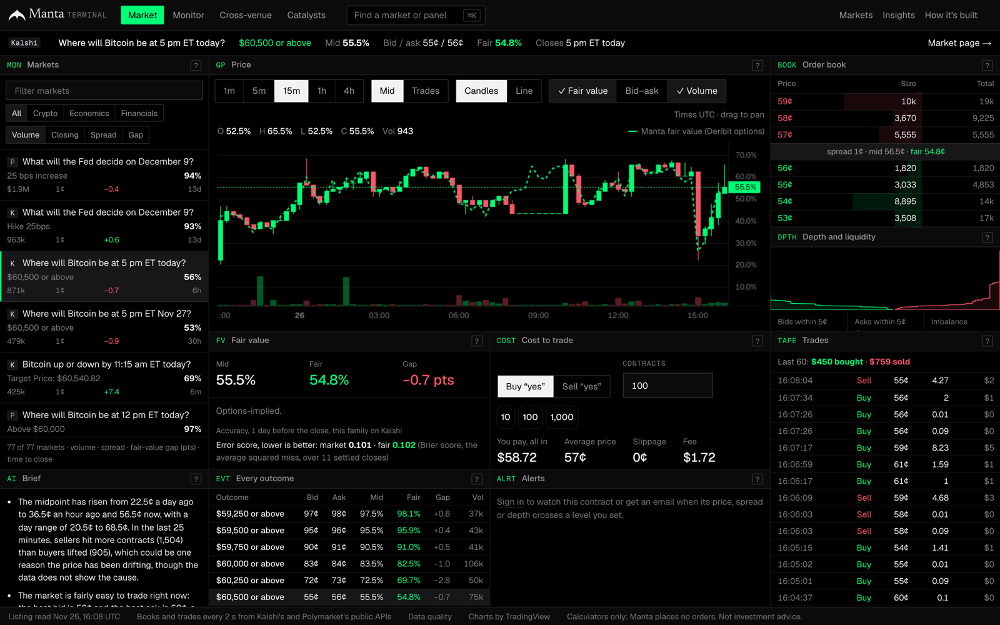

<p align="center">
  <a href="https://mantamarkets.com">
    <picture>
      <source media="(prefers-color-scheme: dark)" srcset="docs/images/header-dark.svg">
      
    </picture>
  </a>
</p>

<p align="center">
  <a href="https://mantamarkets.com">Live site</a> ·
  <a href="docs/product.md">Docs</a> ·
  <a href="LICENSE">License</a>
</p>

<p align="center">
  <a href="https://github.com/carsonturnr/manta-markets/actions/workflows/ci.yml"></a>
  <a href="LICENSE"></a>
  
  
  
  <a href="https://github.com/nautechsystems/nautilus_trader"></a>
</p>

Manta covers the crypto, economics and financial contracts on Kalshi and Polymarket (never sports)
and gives you the tools to work with them: live order books and trades, charts from Manta's own
recordings, what a trade really costs after fees, the same question compared across venues, and
alerts. It is read-only: Manta places no orders.

<p align="center">
  <a href="https://mantamarkets.com/terminal"></a>
</p>

**Built on [NautilusTrader](https://github.com/nautechsystems/nautilus_trader)** (LGPL-3.0), used
as an installed library for the history catalog and backtesting. Manta's own code is the recorder,
the pricing and analytics, the site and the measurement.

## The site

- **Markets** (`/markets`): every open question, busiest first; each opens to its outcomes with
  price, spread, size, volume and the gap to fair value.
- **Market page** (`/m/<venue>/<event>`): one question's chart, order book, depth, trades, cost to
  trade, fair value, every outcome and a short written brief.
- **Terminal** (`/terminal`): the same panels in one live workspace, Kalshi books and trades
  streamed from the recorder, with a ⌘K command bar.
- **Insights** (`/insights`): when trading is cheapest, which price bands the market gets wrong,
  and whether crossing between venues pays after fees.
- **How it's built** (`/how-its-built`): the system, its measured numbers and every recording gap.
- **Accounts**: watchlists, email alerts and an API of Manta's analytics (`/docs/api`).

| Markets | Market page |
|---|---|
| <a href="https://mantamarkets.com/markets"></a> | <a href="https://mantamarkets.com/markets"></a> |

## Numbers

Measured, with their dates. The live figures are on [How it's built](https://mantamarkets.com/how-its-built).

- **3.54 billion** venue messages recorded from 2026-11-12 to 2026-11-26, from six venues.
- **Coverage 99.48% to 99.997%** per venue over that time (the share of time not inside a
  recording gap); Deribit is the lowest.
- **0 book mismatches** in 5.6 million rebuilt order-book updates, checked against the venue
  (2026-11-13).
- **93 ms** median from a Kalshi message reaching the recorder to the terminal receiving it
  (2026-11-23).
- **187 tests**: 66 Go, 57 Python, 64 site (2026-11-26).

## What worked and what did not

- Worked: the recorder. It has run since 2026-11-12, every gap is logged and shown, and it is the
  only source of Kalshi order-book history (Kalshi does not publish one). Charts, replay and the
  terminal's live stream all come from it.
- Did not: fair value as an edge. Priced from Deribit's options, it is **no more accurate than
  Kalshi's own midpoint**: Brier score (average squared miss, lower is better) 0.1322 vs 0.1297
  five minutes before the close, 0.0989 vs 0.0967 one day before. So the site shows it as a
  second opinion with its record, not a signal.
- Did not: cross-venue arbitrage. In a snapshot on 2026-11-26, 9 of 71 questions listed on both
  Kalshi and Polymarket still crossed after both venues' fees, typically by 0.29¢ a contract, and
  all of them together were worth about $6 at the sizes on offer.
- Shelved: a Kalshi market maker (paper trading only), planned but not built.
- A mistake worth recording: the market brief first ran on a large model with thinking, cached
  for 5 minutes, and cost $22 in one day. It now runs on a small model, cached 30 minutes and
  capped per day.

## How it's built

```
venues (Kalshi, Polymarket, Deribit, Coinbase, Kraken, Binance)
   │  WebSocket / REST, read-only
   ▼
recorder (Go, on a VM) ──► raw hourly gzip JSONL ──► nightly archive (Storage Box)
   │        │                     │
   │        │ replay files        └─► backtest/ (Python + NautilusTrader Parquet catalog)
   │        └─► 1-minute candles for the charts
   │ live relay (Kalshi books and trades) ──► terminal
   ▼
pricing jobs (Python, every minute) ──► Postgres (Supabase, schema `manta`)
                                              │  read-only login
                                              ▼
                                   site (Next.js 16, React 19, TypeScript, Vercel)
```

| Folder | What | Stack |
|---|---|---|
| `recorder/` | records raw venue messages; status, replay, relay and normalizer tools | Go |
| `pricing/` | fair values, distributions, liquidity, accuracy, alerts | Python 3.13, uv |
| `backtest/` | recordings → NautilusTrader catalog | Python 3.13, NautilusTrader |
| `site/` | the product site | Next.js, Clerk sign-in, Postgres |
| `db/` | Postgres schema | SQL |
| `infra/deploy/` | VM deploy scripts and systemd units | bash, systemd |
| `docs/` | product spec, design notes per milestone, dated decisions | |

## Run it locally

None of the steps below need an account or a secret.

```
# Tests
cd pricing  && uv run pytest -q
cd recorder && go test ./...
cd site     && npm ci && npm test

# Record live data into ./data/raw (Kalshi through its public REST API when no key is set)
cd recorder && go run ./cmd/recorder -out ../data/raw
go run ./cmd/status -in ../data/raw          # what was recorded, and every gap

# Price Kalshi's Bitcoin contracts from Deribit's options, in the terminal
cd pricing && uv run manta-fair
```

The site reads Postgres. With a local Postgres (any Postgres 15+):

```
createdb manta
cp .env.example .env                 # DATABASE_URL=postgresql://localhost:5432/manta
cd pricing && uv run --env-file ../.env manta-snap --init                  # tables and logins
cd ../recorder && go run ./cmd/contracts -out ../data/contracts.json      # today's listing
cd ../pricing && uv run --env-file ../.env manta-contracts ../data/contracts.json   # fill it
cd ../site && cp .env.example .env.local && npm run dev                    # http://localhost:3000
```

Sign-in, the waitlist, replay and alerts need their own services (Clerk, Resend, the replay
server); `.env.example` and `site/.env.example` list each setting.

## Docs

- [docs/product.md](docs/product.md): the product spec.
- [docs/decisions.md](docs/decisions.md): every decision, dated, with what was measured.
- `docs/milestone-*.md`: design notes for the recorder, pricing, tracker and backtest.

## License

MIT (see [LICENSE](LICENSE)). NautilusTrader, a dependency, is LGPL-3.0 and is used as an installed library, not copied.
